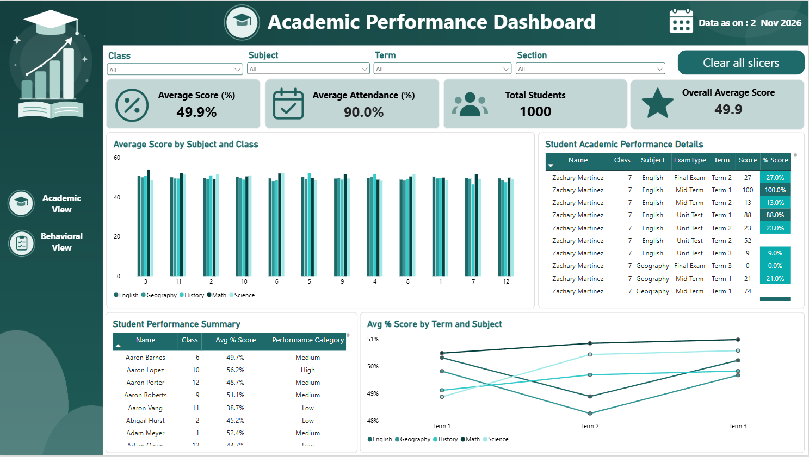
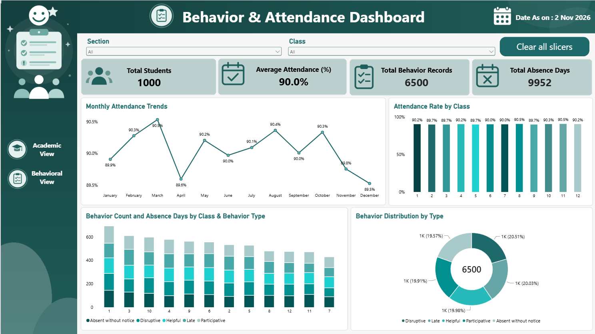

<div align="center">

# 🎓 Student Academic & Behavior Analytics Dashboard 🎓
### *Interactive Power BI Dashboards for Academic Performance, Attendance & Student Behavior*

[](https://powerbi.microsoft.com/)
[](https://learn.microsoft.com/en-us/dax/)
[](https://powerbi.microsoft.com/)
[](https://powerbi.microsoft.com/)

<br/>

> *"Data tells the story of every student — a good dashboard helps us listen."*

</div>

---

## 📋 Table of Contents

- [📌 Overview](#-overview)
- [🎯 Problem Statement](#-problem-statement)
- [✨ Key Features](#-key-features)
- [🏗️ Project Structure](#️-project-structure)
- [🔄 Project Workflow](#-project-workflow)
- [📊 Part A — Academic Performance Dashboard](#-part-a--academic-performance-dashboard)
- [🧠 Part B — Behavior & Attendance Dashboard](#-part-b--behavior--attendance-dashboard)
- [🗃️ Data Model](#️-data-model)
- [🛠️ Tech Stack](#️-tech-stack)
- [📈 Results & Insights](#-results--insights)
- [🏆 Advantages](#-advantages)
- [📄 License](#-license)
- [👤 Author](#-author)
- [🙏 Acknowledgements](#-acknowledgements)

---

## 📌 Overview

The **Student Academic & Behavior Analytics Dashboard** is an interactive, two-page **Power BI** report that turns raw school data into clear, actionable insights. It brings together **exam scores**, **attendance records** and **behavior logs** of **1,000 students across 12 classes** in a single, easy-to-navigate dashboard.

This project is designed to:
- Track academic performance across **subjects, classes, terms and exam types**
- Monitor **attendance trends** month by month
- Understand **behavior patterns** such as late arrivals, disruptions and participation
- Help teachers and administrators quickly **identify students who need support**
- Practice **data modeling, DAX measures and dashboard design** in Power BI

---

## 🎯 Problem Statement

> **Objective:** Build an interactive Power BI report to analyze student academic performance, attendance and behavior.

Schools collect a lot of data — scores, attendance sheets and behavior notes — but it usually lives in separate tables and is hard to read. This project combines everything into one visual story so that decision-makers can filter by **Class, Subject, Term and Section** and instantly see what is happening.

| 📂 Dashboard | 📄 Type | 🔍 Description |
|-------------|---------|----------------|
| Academic Performance | Report Page 1 | Scores, averages and performance categories |
| Behavior & Attendance | Report Page 2 | Attendance trends and behavior distribution |
| Slicers | Filters | Class, Subject, Term, Section with *Clear all slicers* |
| KPI Cards | Metrics | Average score, attendance, total students and more |
| Navigation | Buttons | Switch between *Academic View* and *Behavioral View* |

The goal is to demonstrate **practical data analytics and visualization skills** through a clean, professional dashboard.

---

## ✨ Key Features

| Feature | Description |
|--------|-------------|
| 🧭 **Two-Page Navigation** | Side-menu buttons to jump between Academic and Behavioral views |
| 🎛️ **Dynamic Slicers** | Filter by Class, Subject, Term and Section — plus a one-click *Clear all slicers* |
| 🔢 **KPI Cards** | Average Score %, Average Attendance %, Total Students, Total Behavior Records, Total Absence Days |
| 📊 **Subject vs Class Analysis** | Clustered column chart of average score by subject and class |
| 📈 **Term-wise Trends** | Line chart of average % score by term and subject |
| 🧾 **Detailed Tables** | Student-level scores with conditional formatting on % score |
| 🏅 **Performance Categories** | Students labelled **Low / Medium / High** based on average % score |
| 📅 **Monthly Attendance Trend** | Line chart with data labels for each month |
| 🍩 **Behavior Distribution** | Donut chart showing the share of each behavior type |
| 🎨 **Custom Teal Theme** | Consistent, modern green-teal design with icons and a "Data as on" date |

---

## 🏗️ Project Structure

```
📦 student-analytics-powerbi/
│
├── 📄 Students_Project.pbix        ← Main Power BI report file
│
├── 📁 screenshots/
│   ├── 🖼️ academic_dashboard.png    ← Academic Performance Dashboard
│   └── 🖼️ behavior_dashboard.png    ← Behavior & Attendance Dashboard
│
└── 📄 README.md                    ← Project documentation
```

---

## 🔄 Project Workflow

```
Raw Data (Students, Scores, Attendance, Behavior)
                    │
                    ▼
┌─────────────────────────────────┐
│   Load Data into Power BI       │  ← Get Data / Power Query
└────────────────┬────────────────┘
                 │
                 ▼
┌─────────────────────────────────┐
│   Clean & Transform (Power      │  ← Data types, nulls, columns
│   Query)                        │
└────────────────┬────────────────┘
                 │
                 ▼
┌─────────────────────────────────┐
│   Build Data Model              │  ← Relationships on Student ID
└────────────────┬────────────────┘
                 │
                 ▼
┌─────────────────────────────────┐
│   Create DAX Measures           │  ← Avg Score, Attendance %, etc.
└────────────────┬────────────────┘
                 │
        ┌────────┴─────────┐
        ▼                  ▼
┌──────────────┐   ┌─────────────────┐
│  Page 1:     │   │   Page 2:       │
│  Academic    │   │   Behavior &    │
│  Dashboard   │   │   Attendance    │
└──────┬───────┘   └────────┬────────┘
       │                    │
       └─────────┬──────────┘
                 ▼
   Slicers + Navigation + Insights ✅
```

---

## 📊 Part A — Academic Performance Dashboard

### 📝 1. What does this page show?

The **Academic Performance Dashboard** gives a complete view of how students are performing across subjects, classes, terms and exam types. Four slicers at the top let the user drill down instantly.

<div align="center">



*📸 Academic Performance Dashboard*

</div>

---

### 🗺️ 2. Visuals — Overview

| Visual | Type | Purpose |
|--------|------|---------|
| 1️⃣ **KPI Cards** | Card | Average Score (%), Average Attendance (%), Total Students, Overall Average Score |
| 2️⃣ **Average Score by Subject and Class** | Clustered Column Chart | Compare 5 subjects across 12 classes |
| 3️⃣ **Student Academic Performance Details** | Table | Name, Class, Subject, Exam Type, Term, Score, % Score |
| 4️⃣ **Student Performance Summary** | Table | Name, Class, Avg % Score, Performance Category |
| 5️⃣ **Avg % Score by Term and Subject** | Line Chart | Track subject performance from Term 1 to Term 3 |

---

### 🔢 3. KPI Summary

| 📌 KPI | 💡 Value |
|--------|---------|
| Average Score (%) | **49.9%** |
| Average Attendance (%) | **90.0%** |
| Total Students | **1000** |
| Overall Average Score | **49.9** |

---

### 🏅 4. Performance Category

> Each student is grouped into a category using their **Avg % Score**.

| Category | Meaning |
|----------|---------|
| 🟢 **High** | Strong overall performance |
| 🟡 **Medium** | Average performance |
| 🔴 **Low** | Needs academic support |

---

## 🧠 Part B — Behavior & Attendance Dashboard

### 🔍 5. What does this page show?

The **Behavior & Attendance Dashboard** focuses on how regularly students attend school and how they behave in class. It can be filtered by **Section** and **Class**.

<div align="center">



*📸 Behavior & Attendance Dashboard*

</div>

---

### 🗺️ 6. Visuals — Overview

| Visual | Type | Purpose |
|--------|------|---------|
| 1️⃣ **KPI Cards** | Card | Total Students, Average Attendance (%), Total Behavior Records, Total Absence Days |
| 2️⃣ **Monthly Attendance Trends** | Line Chart | Attendance % from January to December |
| 3️⃣ **Attendance Rate by Class** | Column Chart | Compare attendance across all 12 classes |
| 4️⃣ **Behavior Count and Absence Days by Class & Behavior Type** | Stacked Column Chart | Behavior volume per class by type |
| 5️⃣ **Behavior Distribution by Type** | Donut Chart | Share of each behavior type |

---

### 🔢 7. KPI Summary

| 📌 KPI | 💡 Value |
|--------|---------|
| Total Students | **1000** |
| Average Attendance (%) | **90.0%** |
| Total Behavior Records | **6500** |
| Total Absence Days | **9952** |

---

### 🎭 8. Behavior Types Tracked

| Behavior Type | Nature |
|---------------|--------|
| 🙋 **Participative** | ✅ Positive |
| 🤝 **Helpful** | ✅ Positive |
| ⏰ **Late** | ⚠️ Needs attention |
| 📢 **Disruptive** | ❌ Negative |
| 🚫 **Absent without notice** | ❌ Negative |

---

## 🗃️ Data Model

The report is built on a clean model with **four data tables** and one **measures table**.

| 🗂️ Table | 📄 Type | 🔍 Key Fields |
|----------|---------|---------------|
| **Students** | Dimension | Name, Class, Section |
| **Scores** | Fact | Subject, ExamType, Term, Score, % Score |
| **Attendance** | Fact | Date, Attendance %, Absent Days |
| **Behavior** | Fact | BehaviorType, Behavior Count |
| **_Measures** | Measures Table | Total Students, Avg Score, Avg % Score, Average Score per Subject |

**Key DAX concepts used:**

| Concept | Detail |
|---------|--------|
| ➕ `AVERAGE()` / `SUM()` | Average scores and total absence days |
| 🔢 `DISTINCTCOUNT()` | Total unique students |
| 🔀 `SWITCH()` / `IF()` | Performance Category (Low / Medium / High) |
| 🎯 Measures Table | All measures organized in one `_Measures` table |

---

## 🛠️ Tech Stack

| Tool | Version | Purpose |
|------|---------|---------|
| 📊 **Power BI Desktop** | Latest | Report creation and visualization |
| 🧮 **DAX** | Built-in | Measures and calculated columns |
| 🔧 **Power Query** | Built-in | Data cleaning and transformation |
| 🗃️ **Data Modeling** | Star Schema | Relationships between tables |
| 🎨 **Custom Theme & Icons** | Teal Palette | Professional dashboard design |
| 🔖 **Bookmarks & Buttons** | Built-in | Page navigation and *Clear all slicers* |

---

## 📈 Results & Insights

After exploring the dashboards, the following insights are visible:

- 📉 **Average score is 49.9%** — overall performance is moderate, with room to improve
- 🏫 **Scores are very similar across classes and subjects** — no single class or subject stands far above the rest
- 🔄 **Term-wise trend** — some subjects dip in **Term 2** and recover in **Term 3**
- ✅ **Attendance is steady at about 90%** — monthly attendance stays in a narrow range of **89.5% – 90.5%**
- 📅 **Highest attendance in March (90.5%)**, lowest in **December (89.5%)**
- 🎭 **6,500 behavior records** — the five behavior types are spread almost equally (about 20% each)
- 🚫 **9,952 total absence days** recorded across all students
- 🏅 **Performance Categories** help quickly find **Low** performers who need support

---

## 🏆 Advantages

| Advantage | Detail |
|-----------|--------|
| 🎓 **Easy to Understand** | Clean visuals that teachers and parents can read at a glance |
| 🎛️ **Fully Interactive** | Slicers and cross-filtering update every visual instantly |
| 🔍 **Student-Level Detail** | Drill from overall KPIs down to individual student scores |
| 📚 **Educational** | Great example of KPI cards, line, column, stacked and donut charts |
| 🎨 **Professional Design** | Consistent theme, icons and layout across both pages |
| 🧪 **Extensible** | Easy to add new pages (e.g., Teacher Analysis, Fee Tracking) |
| ⚡ **Fast Decisions** | Helps identify at-risk students early |
| 🔄 **Reusable** | Can be reused for any school by changing the data source |

---

## 📄 License

This project is licensed under the **MIT License** — see the [LICENSE](LICENSE) file for full details.

```
MIT License — Free to use, modify, and distribute with attribution.
```

---

## 👤 Author

<div align="center">

### Ayush Isamaliya

[](https://github.com/isamaliya16)
[](https://www.linkedin.com/in/ayush-isamaliya-686533312/)

> *"Every dashboard starts with a single question — and every answer starts with data."*

**🎓 Role:** Data Analytics Enthusiast | Power BI Developer \
**📍 Location:** India\
**🛠️ Skills:** Power BI · DAX · Data Modeling · Dashboard Design · Data Visualization

</div>

---

## 🙏 Acknowledgements

Special thanks to the following resources and communities that made this project possible:

- 📊 [Microsoft Power BI Docs](https://learn.microsoft.com/en-us/power-bi/) — Official Power BI documentation
- 🧮 [DAX Guide](https://dax.guide/) — Complete DAX function reference
- 🎨 [Power BI Community](https://community.fabric.microsoft.com/) — Tips, tricks and problem solving
- 🖥️ [Microsoft Learn — Data Analyst Path](https://learn.microsoft.com/en-us/training/) — Free learning modules
- 💬 [Stack Overflow Community](https://stackoverflow.com/) — Problem-solving support
- 📖 [Kaggle Learn](https://www.kaggle.com/learn) — Data and analytics courses

---

<div align="center">

---

*Made with ❤️ and ☕ — Last updated: 3 November, 2026*

</div>
